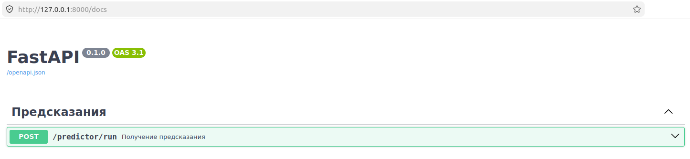
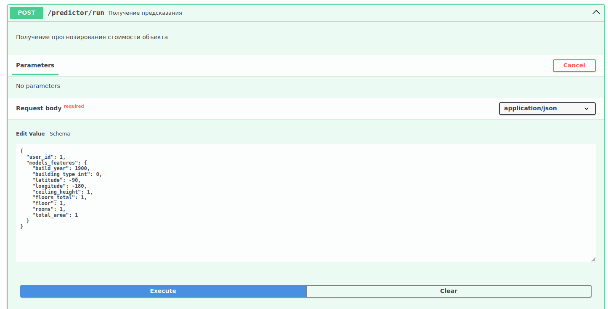
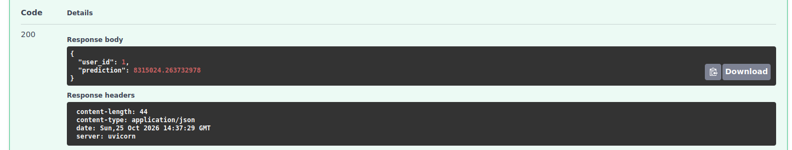
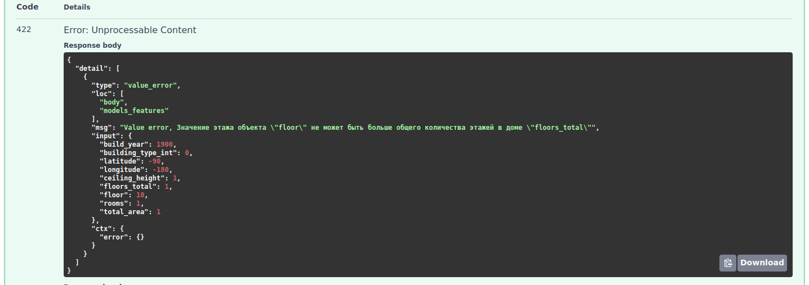

# Инструкции по запуску микросервиса

## 1. FastAPI микросервис в виртуальном окружение

### 1.1. Конфигурация

Создайте файл .env, скопируйте в него содержимое файла 
[.env_template](.env_template) и заполните.

### 1.2. Виртуальное окружение

Создайте виртуальное окружение и активируйте его:

```shell
python -m venv .venv
source .venv/bin/activate
```

Установите зависимости:

```shell
pip install -r services/requirements.txt
```

### 1.3. Запуск приложения

```shell
uvicorn services.ml_service.app:app --host 0.0.0.0 --port 8000
```

При успешном запуске в консоле будут выведены логи:

```
INFO:     Application startup complete.
INFO:     Uvicorn running on http://0.0.0.0:8000 (Press CTRL+C to quit)
```

Перейдите в браузере по адресу http://0.0.0.0:8000/docs:



### Пример запроса из swagger'а:

**Запрос**:



**Ответ**:



**Пример ошибки**:



### Пример curl-запроса к микросервису

```bash
curl -X 'POST' \
  'http://127.0.0.1:8000/predictor/run' \
  -H 'accept: */*' \
  -H 'Content-Type: application/json' \
  -d '{
  "user_id": 1,
  "models_features": {
    "build_year": 1900,
    "building_type_int": 0,
    "latitude": -90,
    "longitude": -180,
    "ceiling_height": 1,
    "floors_total": 1,
    "floor": 1,
    "rooms": 1,
    "total_area": 1
  }
}'
```

## 2. FastAPI микросервис в Docker-контейнере

Перейдите в директорию `services`:

```shell
cd services
```

Соберите образ из docker-file:

```shell
docker build -f Dockerfile_ml_service -t ml-service .
```

Запустите контейнер:

```shell
 docker run --rm -p 8000:8000 ml-service
```

Через параметр `-p` необходимо пробросить порт. Например, `8000:8000`, где: 
* первый порт - порт на вашем хосте;
* второй порт - порт внутри контейнера.

При успешном запуске в консоль будут выведены следующие логи:

```
INFO:ml_service.usecases.catboost_handler:Модель успешно загружена из /app/models/MLmodel.pkl
INFO:     Application startup complete.
INFO:     Uvicorn running on http://0.0.0.0:8000 (Press CTRL+C to quit)
```

Работа с сервисом ничем не отличается от запуска без Docker'а (см. пункт 1).

### Пример curl-запроса к микросервису

```bash
```bash
curl -X 'POST' \
  'http://127.0.0.1:8000/predictor/run' \
  -H 'accept: */*' \
  -H 'Content-Type: application/json' \
  -d '{
  "user_id": 1,
  "models_features": {
    "build_year": 1900,
    "building_type_int": 0,
    "latitude": -90,
    "longitude": -180,
    "ceiling_height": 1,
    "floors_total": 1,
    "floor": 1,
    "rooms": 1,
    "total_area": 1
  }
}'
```

## 3. Docker compose для микросервиса и системы моониторинга

```bash
# команда перехода в нужную директорию

# команда для запуска микросервиса в режиме docker compose

```

### Пример curl-запроса к микросервису

```bash
curl -X 'POST' \
  'http://localhost:
```

## 4. Скрипт симуляции нагрузки
Скрипт генерирует <...> запросов в течение <...> секунд ...

```
# команды необходимые для запуска скрипта
...
```

Адреса сервисов:
- микросервис: http://localhost:<port>
- Prometheus: ...
- Grafana: ...