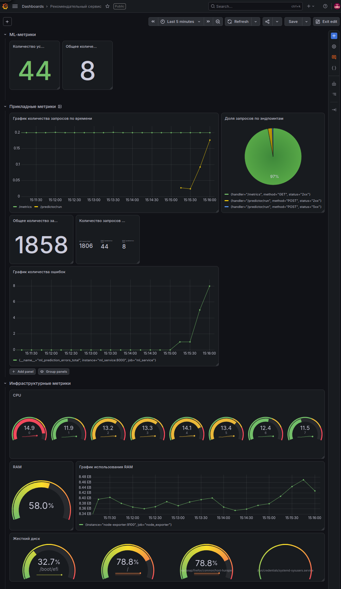

# Мониторинг

Файл с дашбордом: [dashboard.json](docs/dashboard.json)

Дашборд предназначен для мониторинга рекомендательного сервиса (ML-сервиса) 
в реальном времени. 

Он разделен на три логических слоя: 

* ML-метрики; 
* прикладные метрики;
* инфраструктурные метрики. 

Такое разделение позволяет оперативно оценивать состояние системы сверху 
вниз — от корректности работы модели до состояния «железа», — что ускоряет 
поиск причин инцидентов.

## Описание слоев:

### Инфраструткурный слой:

**Загрузка CPU по ядрам**

Эта метрика выбрана, так как позволяет оценить, справляется ли вычислительная 
мощность сервера с текущей нагрузкой, который чувствителен к процессорному 
времени.

Используются gauge-панели, потому что они наглядно показывают текущее значение 
относительно пороговых зон (зелёная — норма, жёлтая — предупреждение, 
красная — критично). Для 8 ядер удобно использовать несколько маленьких 
gauge-панелей в ряд, чтобы сразу увидеть картину по всем ядрам.

**Использование оперативной памяти**

Эта метрика выбрана, так как ML-модели и их зависимости часто потребляют 
значительные объемы памяти, а ее нехватка приводит к падению сервиса.

Используется gauge-панель для мгновенной оценки текущего уровня и линейный 
график для отслеживания динамики использования RAM во времени. Линейный 
график позволяет увидеть тренд — растёт ли потребление памяти или остаётся 
стабильным. 

**Жесткий диск**

Эта метрика выбрана, так как переполнение разделов (особенно корневого /) 
приводит к отказу записи логов, моделей и остановке сервиса.

Используются gauge-панели, потому что для дискового пространства важно видеть 
процент заполнения относительно критического порога (обычно 80–90%)

### Метрики реального времени:

**Количество успешных предсказаний модели**

Эта метрика выбрана, так как это ключевой показатель полезной работы 
ML-сервиса — сколько раз модель успешно выдала результат.

Используется крупная цифровая панель (stat), потому что для 
бизнес-показателя важна мгновенная читаемость абсолютного значения без 
необходимости интерпретировать график.

**Количество ошибок при предсказаниях**

Эта метрика выбрана, так как она напрямую характеризует надёжность ML-модели 
и стабильность сервиса.

Используется stat-панель, потому что важно сразу видеть текущее число ошибок. 

### Метрики прикладного уровня:

**График количества запросов по времени**

Эта метрика выбрана, так как она показывает нагрузку на сервис — сколько 
запросов приходит на эндпоинты в единицу времени.

Используется линейный график, потому что он лучше всего отображает изменение 
метрики во времени, позволяет увидеть тренды, скачки и аномалии. Два цвета 
линии позволяют сравнивать нагрузку на разные эндпоинты.

**Доля запросов по эндпоинтам**

Эта метрика выбрана, так как важно понимать распределение трафика между 
эндпоинтами и соотношение успешных (2xx) и ошибочных (5xx) ответов.

Используется pie chart, потому что она наглядно 
показывает доли категорий в общем объёме.

**Общее количество запросов**

Эта метрика выбрана, так как даёт суммарную картину нагрузки за выбранный 
период.

Используются stat-панели, потому что агрегированные числа за период удобно 
отображать крупным шрифтом, который не требует дополнительных усилий для 
интерпретации графиков.

**График количества ошибок по времени**

Эта метрика выбрана, так как рост числа ошибок — ключевой сигнал о проблемах в 
работе ML-модели или сервиса. 

Используется линейный график, потому что он позволяет отследить момент начала 
роста ошибок и оценить скорость деградации сервиса.